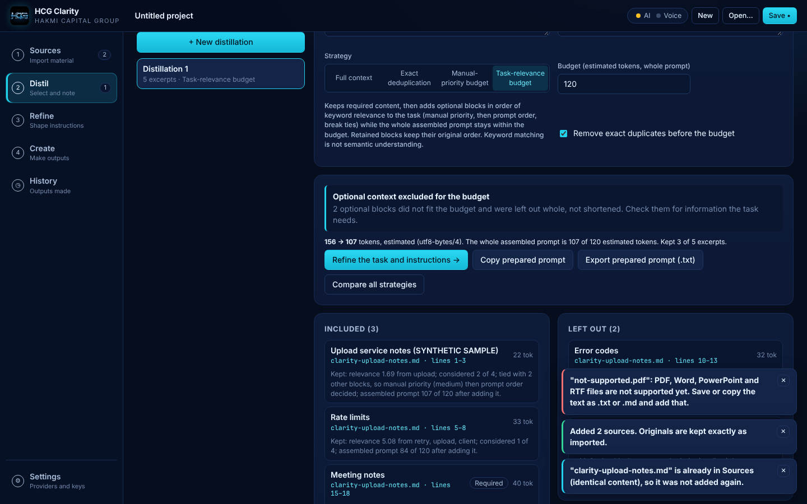
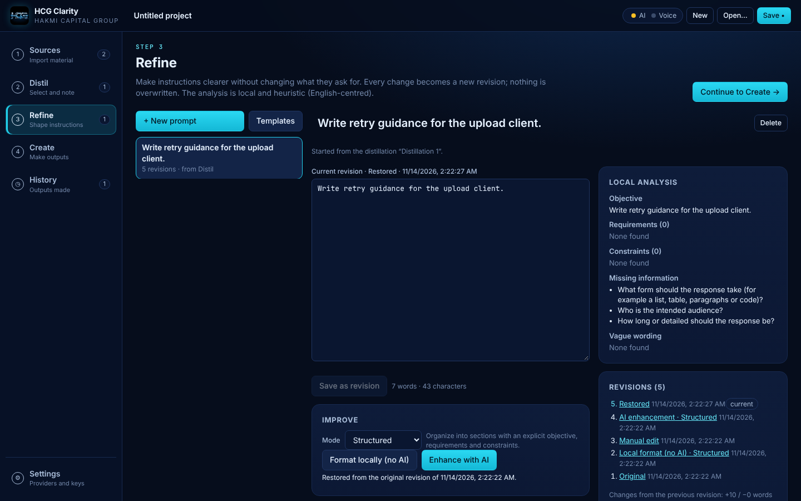

# HCG Clarity

**Turn scattered information into clear instructions and useful deliverables.**
Hakmi Capital Group · version 0.1.0 (first consolidated version, pre-release)

```
Sources  →  Distil  →  Refine  →  Create
import       select       shape          brief · presentation · prompt files
material     + notes      instructions   (every output kept in History)
```

HCG Clarity consolidates the working parts of **HCG RePrompter**, **Distil** and
**Presentation Studio** into one application with one project model, one source library, shared
settings and one output history. See [docs/AUDIT.md](docs/AUDIT.md) for the source audit and the
migration map (what was reused, ported, deferred or excluded, and why).

| Distil | Refine |
|---|---|
|  |  |

<sub>Screenshots from the automated browser test (`npm run test:e2e:clarity`) with synthetic content and the mock AI provider (text marked `[MOCK]`).</sub>

## What it does

| Step | What works |
|---|---|
| **Sources** | Import **PDF** and **Word (.docx)** documents (up to 50 MB), text (`.txt`, `.md`, `.csv`, `.json`, `.html`, … up to 5 MB, strict UTF-8) and images (PNG, JPEG, WebP), or paste text. Originals are stored byte-for-byte with a SHA-256 checksum and never edited. For PDF and Word the text is **extracted** (pdf.js / mammoth) and clearly labelled as such; PDF excerpts also cite the **page** (`report.pdf · p. 2 · lines 8–9`). Scanned PDFs without a text layer are refused (no OCR). Identical files are not added twice. Shows where each source is used. |
| **Distil** | Distil's engine: sources are cut into **excerpts that are exact lines of a source** and keep a reference (`notes.md · lines 4–9`). Four strategies (full, exact dedupe, manual-priority budget, task-relevance budget) with explained decisions, Required/priority per excerpt, comparison of all strategies, credential warning, prepared-prompt copy/export. Optional **AI notes**: every note must cite an excerpt with a quote; quotes not found in the cited excerpt are shown as **unverified**. |
| **Refine** | RePrompter's local analysis (objective, requirements, constraints, missing information, vague wording), local formatter (no AI), 10 templates, six enhancement modes with **AI enhancement** under RePrompter's contract (validated before it is stored, preservation warnings shown). Every change is a **revision**; compare any revision with its parent, restore it as a new revision. Export TXT / Markdown / JSON. |
| **Create** | **Clarity brief** (Markdown): instructions, distilled excerpts verbatim with references, AI notes labelled *AI-derived* with verified/unverified references, source checksums. **Presentation**: Presentation Studio's workflow — fill the brief from a prompt revision and distillation, generate with AI or build from a template without AI, edit, restyle, narrate (ElevenLabs), present, export an **editable `.pptx`** (and `.pptx` + narration ZIP). |
| **History** | Every exported file is kept in the project with links to the prompt, revision, distillation and sources it came from, and can be downloaded again after reopening. |

**Projects** are `.clarity` files (ZIP): sources, excerpts, notes, prompt revisions, outputs and
the deck, with their links. Unsaved work is autosaved locally and offered back after a crash or
closed tab. **Opening older files migrates them:** Presentation Studio `.pstudio`, Distil project
`.json` (schema 3) and HCG RePrompter backup `.json`; a notice says what was and was not carried over.

**Trust boundary.** Imported documents are untrusted. Excerpts are sent to the AI only inside
`<source_material>` / `<excerpt>` elements with explicit rules that they are data, never
instructions; prompts are started from *your* task and instructions only, and distilled material
travels separately. Nothing in a document can trigger a tool or an action: the app has no tool use.
Distilled content is always marked as excerpt (verbatim) or AI-derived.

## Requirements

- Node.js **22.12 or newer** and npm.
- Optional: an Anthropic API key (AI notes, AI enhancement, AI slides) and an ElevenLabs API key
  (voice). Everything else works without keys.
- Desktop packaging: see [docs/DESKTOP.md](docs/DESKTOP.md).

## Setup and run

```bash
npm install
```

```bash
cp .env.example .env
```

Edit `.env` only if you want AI or voice features. Never commit it (it is git-ignored).

```bash
npm run dev
```

Open http://127.0.0.1:5173 (the API server runs on 127.0.0.1:8787 and Vite proxies `/api`).

Production build on one port:

```bash
npm run build
```

```bash
npm start
```

Then open http://127.0.0.1:8787. The server listens on localhost only and has no authentication:
do not expose it to a network.

## Configuration

All values are optional (`.env`, web version; the desktop app stores keys in the OS keychain via Setup).

| Variable | Purpose | Default |
|---|---|---|
| `ANTHROPIC_API_KEY` | Enables AI notes, AI enhancement and AI slides | unset → local features only |
| `ANTHROPIC_MODEL` | Model for all AI features | `claude-opus-5-5` |
| `ANTHROPIC_EFFORT` | `low`/`medium`/`high`/`xhigh`/`max` | `medium` |
| `ANTHROPIC_REFUSAL_FALLBACK` | `off` disables the server-side refusal fallback | on |
| `GENERATION_PROVIDER` | `none` forces local-only mode | auto |
| `ELEVENLABS_API_KEY` | Spoken brief and narration | unset → voice off |
| `ELEVENLABS_TTS_MODEL`, `ELEVENLABS_STT_MODEL` | Voice models | `eleven_multilingual_v2`, `scribe_v2` |
| `PORT`, `HOST` | Server address | `8787`, `127.0.0.1` |

Keys stay in the server process: never sent to the browser, written to projects or exports, or
logged (the tests check this). The AI pill in the top bar shows *not configured / configured /
verified / failed*; Settings opens provider setup and verification.

## Tests

| Command | What it covers |
|---|---|
| `npm test` | Unit and API tests (Vitest): Distil port, RePrompter port, Clarity project files and migration, provenance, notes validation, revisions, brief, server routes (mock provider, cancellation, missing keys), and all Presentation Studio tests |
| `npm run typecheck` | Client, server and desktop TypeScript |
| `npm run test:e2e:clarity` | Browser e2e of the whole workflow with the mock AI provider |
| `npm run test:e2e` | Presentation Studio browser e2e inside the Clarity shell (needs python-pptx and LibreOffice for the export checks) |
| `npm run desktop:pack` then `npm run desktop:test` | Packaged Electron app e2e (Linux here; see docs/DESKTOP.md) |
| `./scripts/check-no-secrets.sh` | Fails if a `.env` file or key-like string is tracked |

Results of the last run are in [docs/TESTING.md](docs/TESTING.md).

## Implemented and deferred

Implemented: everything in *What it does* above.

Deferred (not shown in the UI):

- Import of scanned PDFs (OCR), legacy Word `.doc`, PowerPoint and RTF (refused with a clear message).
- Distil's model tokenizers (`cl100k_base`/`o200k_base`) — counts are labelled estimates.
- Distil's answer-evaluation experiments; RePrompter collections and user-defined templates.
- HCG Connect accounts, HCG AI service, sharing/collaboration (no implementation exists to reuse).
- Audio embedded inside `.pptx` (narration is exported alongside, as in Presentation Studio).
- Relay — excluded; see the audit.

Not verified: real Anthropic and ElevenLabs calls (only mock providers), Microsoft PowerPoint
and Keynote (exports checked with python-pptx and LibreOffice), use of the macOS app by a person
on a Mac (CI builds the Apple Silicon `.app` and DMG and passes the packaged-app test, but the app
is ad-hoc signed and not notarised), screen readers.

## Repository layout

```
src/clarity/   project model, .clarity files + migration, sources, provenance glue, notes, brief
src/distil/    Distil engine (ported from Swift)        src/refine/   RePrompter library (ported)
src/shared/, src/export/, src/project/   deck model, rendering, PPTX export (Presentation Studio)
src/client/    React UI (shell, views, deck editor)     server/      Express API + providers
desktop/       Electron shell                           tests/, e2e/ automated tests
docs/          AUDIT.md, TESTING.md, DESKTOP.md          samples/     synthetic test material
```

## Attribution

Contains code ported or copied from HCG RePrompter (© 2026 Hakmi Capital Group) and from Distil
and Presentation Studio (The Last Sprint / Oslo Sprint 2026). Files ported from Swift name their
origin and source commit in their header; files copied from Presentation Studio are listed in
[NOTICE.md](NOTICE.md), which also has the third-party notices.

---

© 2026 Hakmi Capital Group. All rights reserved.
